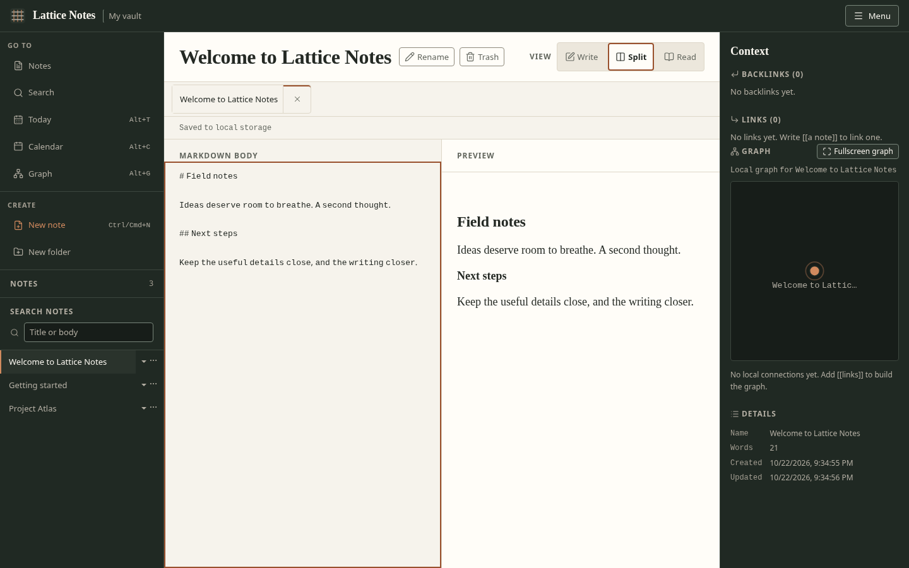

# Lattice Notes

[](https://github.com/anasfik/lattice-notes/actions/workflows/ci.yml)
[](LICENSE)

**Your thoughts. In good company.**

A local-first Markdown workspace that runs entirely in the browser. Notes are
plain Markdown, they live in this browser's IndexedDB, and nothing is uploaded
anywhere: no account, no server, no telemetry.



> **Early development:** keep external backups and use one tab at a time.
> Browser storage is not a disk folder or a backup. See [known limits](#known-limits).

## Features

- Named browser-local vaults, first-use setup, and reversible vault archiving
- Linked notes with `[[wiki links]]`, backlinks, and contextual and fullscreen graphs
- Write, Split and Read modes with open-note tabs
- Full text search, a command palette, and a popup note switcher
- Local-date daily notes and a keyboard-operated calendar
- A trail of the notes: go back and forward through the notes of the session
- Bookmarks of the notes of the vault and an outline of the headings of the note
- Settings for the spell check, the theme, the snapshots and the delete confirmation
- A recovery history: the body of a note is kept before it is replaced
- Import from Markdown files and export to a readable JSON envelope
- Installable, offline capable: the app shell is precached by a service worker

## Quick start

Requires **Node.js 24 LTS** (or Node.js ≥22.12) and npm. No credentials or
environment variables are needed.

```bash
git clone https://github.com/anasfik/lattice-notes.git
cd lattice-notes
npm ci
npm run dev
```

Open the URL Vite prints (usually <http://localhost:5173>). Create a vault,
start with example notes, or import a backup. On small screens, **Index** and
**Context** replace the document temporarily; selecting a note or heading
returns to it without discarding the editor draft.

[Contributing](CONTRIBUTING.md) · [Security](SECURITY.md) ·
[Design system](DESIGN.md) · [Roadmap](docs/superpowers/plans/2026-10-21-feature-roadmap.md)

## Architecture

| Part | What it is | Where it runs |
|---|---|---|
| UI | React 19 + TypeScript, built by Vite | browser |
| Notes | Plain Markdown text | browser |
| Storage | IndexedDB (`lattice-notes`): `vault` (catalog, keyed vault documents, per-vault tab sessions), `settings`, `snapshots` and `bookmarks` | browser |
| Offline shell | A hand written service worker with a build time precache list | browser |

The whole application is static files. There is no backend, no API key and no
account. The vault is written to IndexedDB about 200 ms after the last edit.
If IndexedDB cannot be read, the app keeps working in memory and shows a
warning instead of overwriting anything.

Existing single-vault users keep their original `current` document; migration
only adds catalog metadata. New vaults use `vault:<id>`, tab sessions use
`session:<id>`, and content and session changes are committed together.

The database of the app is at version 3. Version 2 adds the stores of the
settings and of the snapshots and rewrites nothing: the vault documents and
the catalog of a version 1 database are read exactly as they were. Version 3
adds the store of the bookmarks and rewrites nothing either, so a version 1 and
a version 2 database keep their notes, their settings and their snapshots.
**A build that opens the database at version 1 cannot open a version 3 database
at all** — the browser refuses the request, so going back to an older build of
the app after this one has written to the storage leaves that older build
unable to read the vault. Export a backup before you go back.

## Using the workspace

On first use, name a vault and start empty, use example notes, or restore a JSON
backup. **Menu → Vaults** switches, creates, renames, archives and restores
vaults. Archiving hides a vault; it does not delete its notes. Open another vault
before archiving the active one.

- **Ctrl/Cmd+K** opens supported commands; **Ctrl/Cmd+P** opens note search.
- The left **Index** holds navigation, New note, New folder and the note tree;
  **Context** holds links and note information. The app **Menu** holds global
  commands, vaults, import/export and keyboard help.
- **F2** renames the active note; **Alt+T/C/G** opens today, calendar or graph.
  **Menu → Keyboard shortcuts** lists the supported shortcuts.
- **Alt+[** goes back to the note the reader came from and **Alt+]** goes
  forward again. The trail belongs to the tab: a reload starts without one.
- **Menu → Outline of the note** opens the headings of the note on the screen.
  Choosing one jumps to that place in the preview and puts the keyboard there.
  **Menu → Bookmarks** opens the bookmarks of the vault; **Bookmark note**
  (Ctrl/Cmd+K) adds the note on the screen to them. Every bookmark is opened
  and taken off with the keyboard, and the bookmarks are listed in groups by
  their folder. There is no drag to reorder them.
- Folders are virtual groups in note names, such as `Projects/Untitled`, not
  filesystem folders. New folder creates its first note; empty folders are not
  stored. Rename the full path to move a note between groups.
- Closing a note tab does not delete the note. Closing the final tab leaves no
  note selected, including after a reload.
- **Daily note** opens today's `YYYY-MM-DD` note using your local date. Calendar
  days reuse existing daily notes instead of duplicating them.
- The fullscreen **Graph** supports 2D/3D, orbit/pan, zoom, Fit and Reset. Focus
  its picture for arrow keys, `+`/`−`, `0` and `f`; Escape closes it. The picture
  draws at most 300 notes, including the selected note. The searchable list
  reaches every note in pages of 50. Search filters that list, not the picture.
- **Menu → Export vault** downloads the visible vault. Keep backups: clearing
  browser site data, losing this browser profile, or changing origin does not
  transfer your notes. This is browser storage, not access to a disk folder.

## Settings, recovery and the permanent delete

**Menu → Settings** opens the settings of the app. They are stored in this
browser, next to the notes, and a setting that cannot be written is a message
in the status line — it never stops a note from being saved.

| Setting | What it does | Default |
|---|---|---|
| Ask before trashing a note | A note is only moved to the trash after you confirm it. A trashed note stays recoverable either way. | off |
| Snapshot interval | How long the app waits before it keeps a copy of a body. 0 turns the history off. | 5 minutes |
| Snapshot retention | How long a kept body stays recoverable (1 to 90 days). | 30 days |
| Spell check in the editor | The browser marks the words it does not know. | on |
| Theme | Follow the system, light or dark. | Follow the system |

**Menu → Recover note** opens the history of the note that is on the screen.
Before a body is replaced by a save, the old body is kept, and the dialog
lists the kept bodies with the size of the change each one would bring.
Restoring one puts that body back; the body that was on the screen is kept as
well, so a restore can be undone the same way. The history belongs to one note
in one vault and is never mixed with the history of another note.

Snapshots respect the configured interval: edits within that interval do not
each produce a new recovery point. History is capped at 8 MiB of UTF-8 body
text per vault, with oldest snapshots removed first; storage pressure may
reclaim more history so saving the current note takes priority. Snapshots
are not an independent backup.

**Delete note permanently** (Ctrl/Cmd+K → the command palette) is the only
action of the app that cannot be undone. It asks for the name of the note
before it does anything, and it offers **Export backup** first, so the vault
can be taken out of the browser before the note is removed. The note leaves
the vault and its history goes with it.

The kept bodies hold the full text of your notes. They live in the same
browser origin as the vault, so **clearing site data, losing the browser
profile or changing origin loses them as well**. Keep an export if the text
matters to you.

## What Lattice Notes does not do

- **No canvas and no bases.** An infinite board and property driven tables
  are a second document model; they are not planned.
- **No sync, no account, no server.** The product is local-first.
- **No plugin system.** There is no third party code path.
- **No custom hotkeys, ribbon or pop-out windows.** The shortcuts are the
  ones the product owns.
- **No reordering of the bookmarks.** They are listed in groups, by name.
- **No full application parity.** This is an original browser workspace that
  keeps notes in IndexedDB, not a folder of Markdown files.

## Running it locally

```bash
npm ci             # install the versions in package-lock.json
npm run dev        # use the local URL printed by Vite
npm test           # the whole test suite (vitest, jsdom, fake-indexeddb)
npm run build      # type check and production build into dist/
npm run preview    # serve the production build; use the URL printed by Vite
```

The development server never registers the service worker, so the offline shell
only exists in a production build. Use `npm run preview` to try the offline
behaviour.

CI runs `npm ci`, `npm test` and `npm run build` on pushes and pull requests.
To host it yourself, serve `dist/` from an HTTPS static host (localhost also
supports the service worker). No hosting or public demo is configured here.
Keep the same origin to retain browser-local notes; export before moving hosts.

## Import and export

**Export vault** writes the notes of the current tab to
`lattice-notes-vault.json`. The export is made from the in-memory vault, never
from a re-read of the storage, so it also works while the storage warning is
showing and the notes of the tab can be rescued before the recovery path
replaces an unreadable vault.

The envelope is plain JSON and stays readable without this app:

```json
{
  "app": "lattice-notes",
  "formatVersion": 1,
  "notes": [
    {
      "name": "Getting started",
      "body": "# Getting started\n\n…",
      "createdAt": "2026-10-20T07:00:00.000Z",
      "updatedAt": "2026-10-20T07:00:00.000Z"
    }
  ]
}
```

Only active notes are exported, sorted by name. Internal ids are not part of
the format: an import gives every note a fresh id. The envelope holds the
notes only: the bookmarks of the vault stay in the browser and are not part of
the export.

**Import Markdown** accepts `.md`, `.markdown`, `.txt` and the JSON envelope in
one selection. The file extension decides the path: `.json` is read as an
envelope, every other accepted extension is read as one Markdown note per file
(with the extension stripped from the note name). Anything else is skipped.

Import always merges. An existing note is never overwritten, erased or
truncated; a colliding name gets the usual `Name 2` suffix. The result is
announced in the status line, including what was skipped and why:

| Limit | Value | Reported as |
|---|---|---|
| Markdown file size | 1 MiB (1,048,576 bytes) per file | `too large` |
| Markdown files per selection | 500 | `over the batch limit` |
| JSON envelope size | 50 MiB (52,428,800 bytes) | `too large` |
| Notes in a JSON envelope | 20,000 | `over the batch limit` |
| File type | `.md`, `.markdown`, `.txt`, `.json` | `unsupported type` |

The JSON envelope has its own ceilings and is not subject to the Markdown file
or batch limits, so a vault with several large notes stays importable. An
envelope with more than 20,000 notes imports the notes inside the ceiling and
reports the rest as `over the batch limit`. A malformed envelope is an error in
the warning banner; it changes nothing in the vault.

## The Markdown subset

The parser is deliberately small and never produces HTML, so imported Markdown
cannot execute anything.

- ATX headings (`#` to `######`)
- Paragraphs
- Unordered (`-`, `*`, `+`) and ordered (`1.`, `1)`) lists
- Block quotes (`>`)
- Fenced code blocks (```` ``` ```` or `~~~`, with an optional language)
- Inline emphasis (`*text*`), strong (`**text**`) and inline code (`` `code` ``)
- Links (`[label](https://example.org)`); only `http`, `https`, `mailto` and
  relative targets become links
- Wiki links (`[[note]]`, `[[note|alias]]`, `[[note#heading]]`)
- Tags (`#tag`)
- Backslash escapes

One run of inline text is limited to 20,000 characters. A longer run is kept
as plain text instead of being parsed, so a pathological file cannot slow the
editor down. Raw markup in a note body stays visible text.

## The offline shell

`public/sw.js` is a hand written service worker template. The build fills its
two markers and writes `dist/sw.js`:

- The cache version is a SHA-256 hash of the worker template and of every
  precached file, so an identical rebuild keeps the same worker and any change
  produces a new one.
- The precache list is every file of the finished build, plus `./` and
  `./index.html`. The worker script itself is never in its own list.
- On activation only caches whose name starts with `lattice-notes-shell-` and
  is not the current one are deleted. Caches of other applications on the same
  origin are left alone.
- Navigations are network first with the precached `index.html` as the offline
  fallback, so a rebuild is picked up as soon as the browser is online again.
  Other same origin requests are served from the cache first.

## Known limits

- **Two tabs are last writer wins.** The whole vault is written as one
  document, so a second tab that was opened before the first one saved can
  overwrite the changes of the first tab. Use one tab at a time.
- **The trail of the notes is gone after a reload.** Back and forward live in
  the tab and are never written to the storage, so a reload, a new tab or a
  new vault starts without one. The bookmarks are kept: they belong to the
  vault.
- **The last keystroke can be lost.** Writes are debounced by 200 ms. Closing
  the tab immediately after a keystroke can lose that keystroke.
- **The recovery path refuses to guess.** A retry re-reads the stored vault: it
  refuses to write over a vault that has become readable, and only replaces a
  still unreadable one after a second, explicitly warned retry.
- **A corrupt catalog is not reset automatically.** Retry and in-memory export
  remain available; automatic catalog repair is deliberately not implemented.
- **No sync, plugins or filesystem vaults.** Import/export are the portable
  boundary. This is an original browser workspace, not full application parity.
- **A downgrade to an older build is not supported.** The database of the app
  is at version 3, and a build that opens it at version 1 cannot open it at
  all. Export a backup before you go back to an older build.

See the [workspace acceptance record](docs/verification/2026-10-20-workspace.md)
for tested workflows, browser evidence and remaining limitations.
The latest [design verification](docs/verification/2026-10-22-design-refinement.md)
and [layout verification](docs/verification/2026-10-22-layout-repair.md) include
mobile scrolling, keyboard and accessibility checks. They also disclose checks
not run and independent-review availability limits; this is not a claim of
complete accessibility certification or full application parity.

## Reference material

The workspace layout and the local-first approach were informed by a bounded,
read-only static analysis of an Obsidian Desktop bootstrap archive, kept
outside this repository. That
analysis read archive headers and hashes only: no proprietary code was
executed and nothing was copied into this project.

Lattice Notes is an independent implementation. It does not claim runtime
parity with Obsidian, and it does not implement the Obsidian file format or
vault layout. Notes here are Markdown in IndexedDB, not a folder of Markdown
files in a vault directory.

## License

MIT. See [LICENSE](LICENSE).
